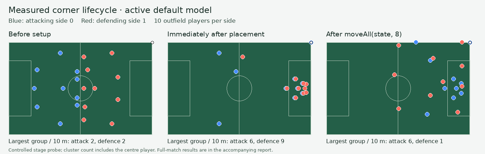

# Set-piece movement measurement — 2026-10-22

The measured default path moves both teams, but retains an attacking box group while releasing the defensive set-piece placement into ordinary shape movement. A separate stage probe reproduces that asymmetry. The earlier description of a stationary defending team was unverified and is withdrawn.

## Scope and method

- Source: commit `70eec53e32ffdac76742908153868a484d07760e`; measured engine/contract files had no local changes. The existing `MATCH_MODEL_RELEASE.enabled` is false. Local unrelated UI edits are outside these measurements.
- Seed: `set-piece-measure-261022`; the first two non-owned ENG top-tier clubs; fixture IDs `set-piece-probe-0` through `set-piece-probe-3`.
- Four tactic pairings: balanced/possession, possession/press, press/counter and counter/balanced. Each pairing runs once on the default model and once with explicit `MATCH_MODEL_REVISION`: eight full matches, 89 corners.
- Coordinates are engine metres. Outfield slots 1–10 only. A group's size is the maximum number of teammates within 10 m of one teammate, including that centre player. This is a descriptive concentration measure, not a football correctness threshold.
- Movement compares the preceding trace entry with corner completion, including preparation and delivery; these distances are not speeds. The figure below is a separate controlled stage probe, not a capture of the user's exact game.

## Full-match results

| Path | Corners | Role | Mean players moving >1 m | Mean displacement | Mean largest 10 m group |
|---|---:|---|---:|---:|---:|
| default | 37 | attacking | 9.24 | 30.13 m | 6.43 |
| default | 37 | defending | 9.89 | 15.14 m | 2.16 |
| candidate | 52 | attacking | 9.25 | 25.39 m | 5.38 |
| candidate | 52 | defending | 9.38 | 17.14 m | 5.44 |

Neither default side was wholly stationary across any of the 37 measured corner transitions. The candidate had one transition with no >1 m movement on each side; the aggregate does not establish why that transition is stationary. No measured corner-completion snapshot had seven outfield teammates within 5 m of one teammate. Literal whole-team collapse into a single point was not reproduced by this probe.

## Controlled lifecycle probe

At elapsed 600 s, side 0 attacks a corner at `[105, 0.5]` with balanced/possession tactics. The existing functions run in sequence: `setPieceTargets` → `placeAtOnce` → `moveAll(state, 8)`.

| Stage | Attacking 10 m group | Defending 10 m group | Attacking retained run jobs | Defending retained run jobs |
|---|---:|---:|---:|---:|
| before setup | 2 | 2 | 0 | 0 |
| immediately placed | 6 | 9 | 6 | 0 |
| after ordinary movement call | 6 | 1 | 6 | 0 |



`placeAtOnce` places both `scene.up` and `scene.marks`. `holdSetPiece` retains runs only for `scene.up`; after the default engine's restart resolution it calls `moveAll(s, 8)`. The controlled probe isolates the resulting placement-release asymmetry. It does not include the full duel/outcome application between these stages, so it is evidence of the mechanism rather than proof of every live corner's cause. The candidate uses another preparation/coordination path and must be assessed separately rather than receiving a blind copy of a legacy fix.

## Ball ownership presentation

All 508 default and 2,954 candidate motion samples with an `ownerId` map to a player in the recorded squads. Those are 508/3,040 and 2,954/5,756 samples respectively; owner absence during a pass, shot or restart is not evidence that the other team owns the ball. `Pitch.tsx` currently puts the carrier text behind both `details` and `inspect`, so ordinary observation lacks this persistent readable cue. A normal-view team indicator and a recorded-carrier marker can use this information; flight/loose/unknown states need explicit neutral handling or an authoritative recorded side.

## Reproduction and limits

```bash
pnpm exec tsx docs/benchmarks/set-piece-motion-261022-reproduce.ts /tmp/set-piece-motion-rerun.json
pnpm exec tsx docs/benchmarks/set-piece-motion-261022-stages.ts /tmp/set-piece-stages-rerun.json
```

[Full-match readings and selected recorded coordinates](set-piece-motion-261022.json), [stage coordinates](set-piece-motion-261022-stages.json).

This is a seeded measurement of the local engine and its emitted playback samples, not a browser capture, a broad balance verdict, or reproduction of an unavailable user save. It identifies a concrete default-path asymmetry and prevents the task from assuming that only one side moves. T348 owns the lifecycle correction under the existing model/activation rules; T350 owns visible ball ownership. T349 retains the requested goal feedback.
